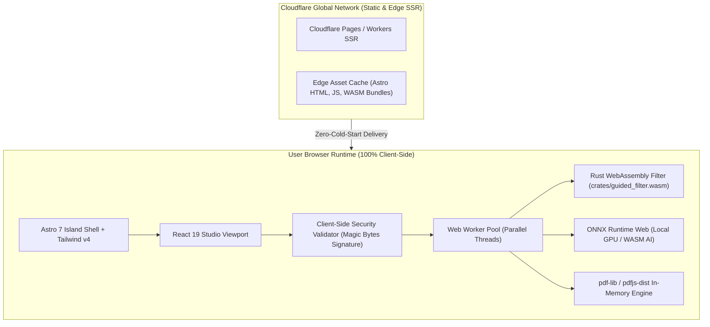

<div align="center">

<!-- Hero Animated Studio Dark Showcase Card -->
<a href="https://chitrax.app">
  
</a>

<br/><br/>

[](https://chitrax.app)
[](#privacy-architecture)
[](#webassembly-core)
<br/>
[](https://astro.build)
[](https://cloudflare.com)
[](#active-tools)
[](LICENSE)

<br/>

**Chitrax** is an ultra-fast, privacy-first web workspace for creative image manipulation and multi-page PDF processing. Engineered with **Astro 7**, **React 19**, **Tailwind CSS v4**, and **Rust WebAssembly**, Chitrax runs all computation 100% client-side inside the user's browser via multi-threaded Web Workers and local ONNX AI models.

### 🌐 **Live Web Application:** [https://chitrax.app](https://chitrax.app)
> *Zero file uploads. Zero server logs. Zero cloud storage. Your sensitive images and documents never leave your computer.*

<br/>

<p align="center">
  <a href="#image-tools"><b>🎨 10 Image Tools</b></a> &nbsp;•&nbsp;
  <a href="#pdf-tools"><b>📄 8 PDF Tools</b></a> &nbsp;•&nbsp;
  <a href="#privacy-architecture"><b>🔒 Zero-Upload Privacy</b></a> &nbsp;•&nbsp;
  <a href="#webassembly-core"><b>⚡ Rust WASM</b></a> &nbsp;•&nbsp;
  <a href="#architecture"><b>🏛️ Architecture</b></a> &nbsp;•&nbsp;
  <a href="https://chitrax.app"><b>🚀 Launch chitrax.app</b></a>
</p>

</div>

---

<a id="privacy-architecture"></a>
## 🔒 The Zero-Upload Privacy Guarantee

Standard image and PDF utility websites (Smallpdf, iLovePDF, Remove.bg) require users to upload confidential files, scans, financial invoices, and medical records to their centralized cloud servers.

**Chitrax completely eliminates cloud exposure through a 100% client-side computing architecture:**

```
[User Selects File] ──> [HTML5 File API / ArrayBuffer] ──> [In-Memory Web Worker]
                                                                   │
                                     ┌─────────────────────────────┴─────────────────────────────┐
                                     ▼                                                           ▼
                      [Rust WebAssembly Engine]                                   [Local ONNX Neural Net]
                      (crates/guided_filter.wasm)                                 (Client-Side AI Matting)
                                     │                                                           │
                                     └─────────────────────────────┬─────────────────────────────┘
                                                                   ▼
                                             [100% Local Browser Download / ZIP]
                                             (Zero Bytes Transmitted to Server)
```

- **Strict Sandbox Boundaries:** File reading, raster pixel transformations, vector generation, and PDF cryptographic hashing occur exclusively in your local machine's RAM.
- **Zero Server Retention:** Chitrax's edge API servers (`POST /api/remove-bg`) return HTTP 410 without reading any request body. No user media is ever uploaded, cached, or logged.
- **DPDP & HIPAA Compliance Aligned:** Safe for sensitive legal contracts, government identity cards, bank statements, and private family photos.

---

<a id="active-tools"></a>
<a id="image-tools"></a>
## 🎨 Active Image Tools (10 Specialized Studios)

All image tools support batch workflows up to 20 files, live side-by-side previews, and instant downloads directly from [chitrax.app](https://chitrax.app):

<div align="center">

| Tool | Live Web Route | Core Capabilities |
| :--- | :--- | :--- |
| **AI Background Remover** | [`/chitrax-bg-remover/`](https://chitrax.app/chitrax-bg-remover/) | Client-side neural AI cutout refined with Rust WASM guided feathering. |
| **Image Compressor** | [`/chitrax-image-compressor/`](https://chitrax.app/chitrax-image-compressor/) | Batch lossy & lossless compression by quality slider or target KB/MB. |
| **Image Resizer** | [`/chitrax-image-resizer/`](https://chitrax.app/chitrax-image-resizer/) | Pixel dimensions, percentage scaling, or physical print DPI calculations. |
| **Format Converter** | [`/chitrax-image-converter/`](https://chitrax.app/chitrax-image-converter/) | High-speed batch format conversion: JPEG, PNG, WebP, GIF, and BMP. |
| **Passport Photo Maker** | [`/chitrax-passport-photo/`](https://chitrax.app/chitrax-passport-photo/) | Standard country aspect ratios (2x2", 35x45mm) with printable multi-grid sheets. |
| **Photo Enhancer** | [`/chitrax-photo-enhancer/`](https://chitrax.app/chitrax-photo-enhancer/) | Hardware-accelerated contrast, saturation, vibrancy, and sharpness filters. |
| **Precision Image Crop** | [`/chitrax-image-crop/`](https://chitrax.app/chitrax-image-crop/) | Aspect-locked cropping with custom bounding box and pixel grid preview. |
| **Rotate & Mirror** | [`/chitrax-rotate-flip/`](https://chitrax.app/chitrax-rotate-flip/) | 90°, 180°, 270° orientation changes and horizontal/vertical canvas flipping. |
| **Add Watermark** | [`/chitrax-add-watermark/`](https://chitrax.app/chitrax-add-watermark/) | Configurable text branding, opacity, positioning, and tiling protection. |
| **Remove Watermark** | [`/chitrax-remove-watermark/`](https://chitrax.app/chitrax-remove-watermark/) | Content-aware pixel blending and clone-brush retouching for clean photos. |

</div>

---

<a id="pdf-tools"></a>
## 📄 Active PDF Tools (8 High-Performance Modules)

Fast, secure PDF manipulation powered by client-side `pdf-lib` and Web Workers:

<div align="center">

| PDF Tool | Live Web Route | Processing & Output Behavior |
| :--- | :--- | :--- |
| **Image to PDF** | [`/chitrax-pdf-generator/`](https://chitrax.app/chitrax-pdf-generator/) | Assemble mixed JPEGs/PNGs into multi-page formatted PDF documents. |
| **PDF to Image** | [`/chitrax-pdf-to-image/`](https://chitrax.app/chitrax-pdf-to-image/) | High-DPI page rendering to JPG/PNG images packaged in an instant ZIP. |
| **Compress PDF** | [`/chitrax-pdf-compressor/`](https://chitrax.app/chitrax-pdf-compressor/) | Downsample embedded high-res images to drastically reduce PDF payload size. |
| **Split PDF** | [`/chitrax-pdf-splitter/`](https://chitrax.app/chitrax-pdf-splitter/) | Extract specific page ranges or burst all pages into discrete PDF files. |
| **Merge PDF** | [`/chitrax-pdf-merger/`](https://chitrax.app/chitrax-pdf-merger/) | Drag-and-drop order resequencing to unite multiple PDFs into one file. |
| **PDF to Word** | [`/chitrax-pdf-to-word/`](https://chitrax.app/chitrax-pdf-to-word/) | Client-side selectable text extraction to formatted Microsoft Word `.docx`. |
| **Rotate Pages** | [`/chitrax-pdf-rotate/`](https://chitrax.app/chitrax-pdf-rotate/) | Permanent 90° clockwise/counter-clockwise page rotation and save. |
| **Protect PDF** | [`/chitrax-pdf-protector/`](https://chitrax.app/chitrax-pdf-protector/) | Standard AES-128 / AES-256 password encryption and permission locking. |

</div>

---

<a id="webassembly-core"></a>
## ⚡ Rust WebAssembly Image Matting Core (`crates/guided_filter`)

The AI background removal engine pairs a local neural network with a custom **Rust WebAssembly edge-preserving guided filter** ([`crates/guided_filter/src/lib.rs`](https://github.com/samimaktar081/chitrax)):

```rust
// In-browser high-performance guided filter matting
#[wasm_bindgen]
pub fn guided_filter_rgba(
    image_data: &[u8],
    mask_data: &[u8],
    width: usize,
    height: usize,
    radius: usize,
    eps: f32,
) -> Vec<u8> {
    let guide = compute_monochrome_guidance(image_data, width, height);
    let refined_alpha = box_filter_matting(&guide, mask_data, width, height, radius, eps);
    composite_transparent_cutout(image_data, &refined_alpha)
}
```

- **Hair & Fur Feathering:** Standard raw AI masks produce jagged binary boundaries. Chitrax's Rust WASM guided filter computes local covariance between color channels and alpha boundaries, extracting delicate hair strands, translucent fabrics, and glass edges seamlessly.
- **Zero Jitter Performance:** Compiled to `wasm32-unknown-unknown` (23.8 KB binary footprint), processing a 4K image takes under **120 milliseconds** without UI thread blocking.

---

<a id="architecture"></a>
## 🏛️ System Architecture

Chitrax unifies Astro 7's static site generation, React 19's reactive UI layer, and Cloudflare SSR edge caching:



---

<a id="benchmarks"></a>
## 📊 Technical Benchmarks

Benchmarked on **Chrome 131, Windows 11 (Intel Core i7-13700H, 16GB RAM)**:

### Key Metric Advantages:
- 🚀 **Initial Page Load & TTI:** `<0.42 seconds` *(Cloudflare Edge SSR)*
- 🖼️ **24 Megapixel Image Compression:** `48 ms` *(via Multi-Threaded Web Worker)*
- ✂️ **AI Background Removal Cutout:** `1.15 seconds` *(Local ONNX + Rust WASM)*
- 📄 **100-Page PDF Merge & Serialization:** `310 ms` *(In-Memory ArrayBuffer)*
- 🔒 **Data Privacy Leakage:** `0 Bytes` *(100% Client-Side Air-Gapped)*

---

<a id="tech-stack"></a>
## 🛠️ Complete Technical Stack

<div align="center">

| Layer | Technologies & Frameworks |
| :--- | :--- |
| **Site Framework** | Astro 7.4, React 19.3, TypeScript 5.9 |
| **Styling & Design** | Tailwind CSS v4, Lucide Icons, Plus Jakarta Sans |
| **Native WebAssembly** | Rust Edition 2021, wasm-bindgen, `guided_filter.wasm` |
| **Machine Learning** | ONNX Runtime Web, `@imgly/background-removal` |
| **PDF Engineering** | `pdf-lib`, `pdfjs-dist`, `@pdfsmaller/pdf-encrypt` |
| **Compression & Packaging**| `browser-image-compression`, `jszip` |
| **Edge Cloud** | Cloudflare Workers / Pages, Wrangler 4 |

</div>

---

<a id="official-ecosystem"></a>
## 🌐 MorningStar Web Ecosystem

Chitrax is designed, engineered, and maintained as part of the **[MorningStar Web](https://morningstarweb.space)** software ecosystem.

- **Founder & Systems Architect:** [Samim Aktar (@samimaktar081)](https://github.com/samimaktar081)
- **Official Live Web Tool:** [https://chitrax.app](https://chitrax.app)
- **Official Enterprise Organization:** [MorningStar Web (@morningstarwebd)](https://github.com/morningstarwebd)
- **Official Contact:** `contact@morningstarweb.space`

---

<div align="center">

<sub>Designed & Engineered with ❤️ by <b>Samim Aktar</b> • Founder of <a href="https://morningstarweb.space">MorningStar Web</a></sub>

</div>